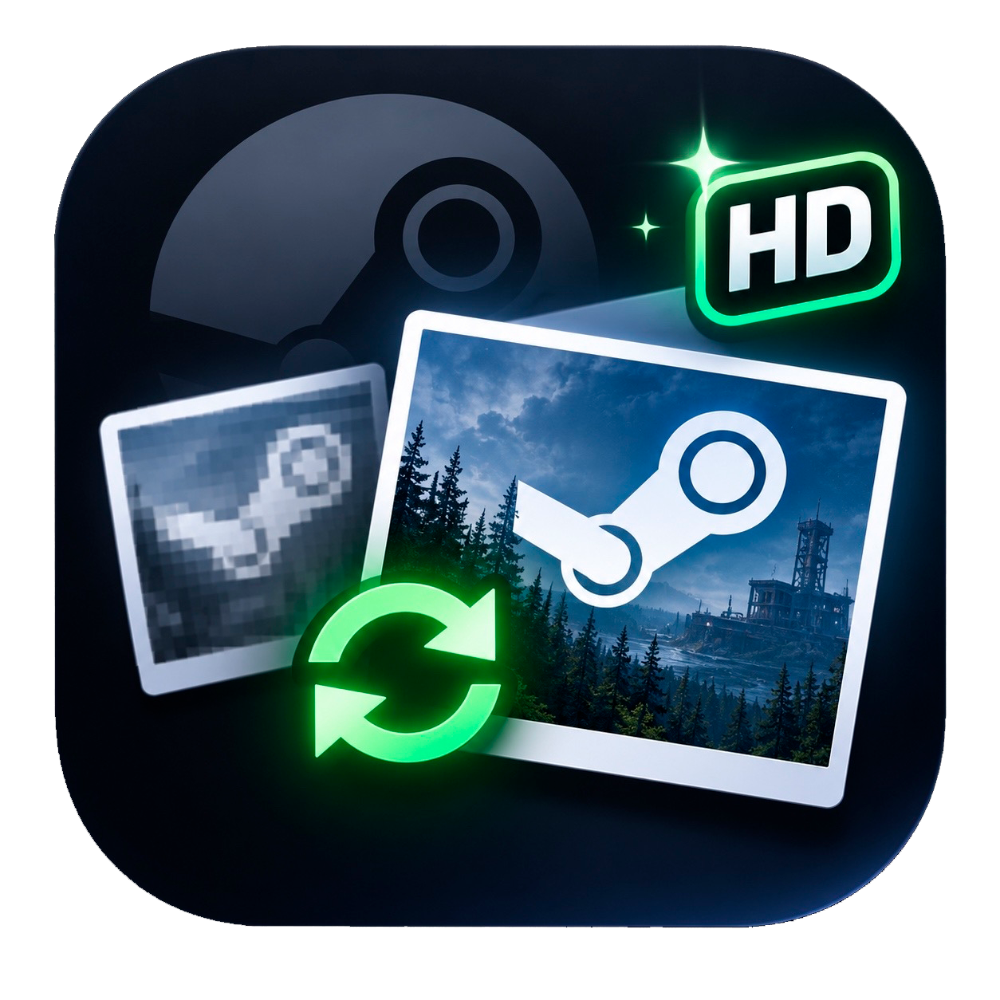

#  ⚡ ScreenHDSteam Studio (v3.0 AUTO


**ScreenHDSteam Studio** - это современная минималистичная утилита на Python с графическим интерфейсом, созданная специально для любителей виртуальной фотографии в играх. Программа решает проблему агрессивного сжатия скриншотов в клиенте Steam, автоматически заменяя стандартные облачные копии на несжатые оригиналы высокого качества.

---

## 🛑 Проблема

Когда вы нажимаете **F12** в игре, Steam делает два кадра. Первый - это сжатый JPEG размером около 600 КБ для облака. Второй - качественный несжатый PNG во внешнюю папку. 

Загрузить в свой профиль Steam качественный кадр стандартными средствами невозможно. Клиент принудительно синхронизирует только пережатую картинку, уничтожая детализацию текстур и эффекты, что особенно заметно в технологичных играх вроде Cyberpunk 2077 или Bodycam.

---

## 🚀 Решение и Возможности

* **Глобальная автоматизация Steam:** Программа самостоятельно сканирует систему, реестр Windows и все подключенные библиотеки на любых жестких дисках для поиска скриншотов.
* **Умный выпадающий список:** Забудьте про ручной ввод путей. В окне настроек появился интерактивный выбор игр, где отображаются исключительно те установленные игры, для которых на вашем компьютере физически обнаружены снимки экрана.
* **Локальное определение названий:** Реальные имена игр считываются напрямую из файлов манифестов на вашем ПК. Приложение работает мгновенно и полностью автономно без запросов к интернету.
* **Автоопределение папки HD:** Скрипт проверяет глобальные настройки вашего клиента Steam и автоматически подтягивает путь к папке сохранения несжатых скриншотов высокого качества.
* **Интуитивный Multi-Select:** Больше не нужно зажимать Ctrl. Выделяйте нужные кадры обычными кликами мыши. Выбранные элементы подсвечиваются яркой неоновой рамкой.
* **Обход блокировок файловой системы:** Скрипт принудительно обходит защиту дескрипторов Windows, на лету перекодируя файлы в идеальный JPEG со стопроцентным качеством без субсэмплинга, одновременно обновляя основной файл и превью-миниатюру.
* **Идеальная сетка галереи:** Устранен визуальный дефект скролла. Карточки скриншотов аккуратно обрезаются по границам окон при прокрутке, имеют фиксированные размеры в сетке и ровно выравниваются по левому краю.
* **Фирменный стиль:** Приложение получило собственную уникальную иконку высокого разрешения, которая отображается в углу окон, на панели задач и в шапке интерфейса.
* **Автоочистка памяти:** После успешного апгрейда программа автоматически удаляет оригиналы из папки источника, чтобы они не занимали лишнее место на диске.

---

## ⚙️ Настройка и Использование

1. Откройте **Steam** -> **Настройки** -> **В игре**. Включите тумблер *"Сохранять внешние копии моих скриншотов"* и выберите формат **PNG**.
2. Запустите **ScreenHDSteam**.
3. Нажмите кнопку **⚙ Настройки** в правом верхнем углу программы.
4. Программа автоматически найдет путь к вашей папке HD и выведет список установленных игр. Вам остается только выбрать нужную игру из выпадающего меню и нажать **Сохранить настройки**.
5. Сделайте скриншот в игре (F12), перейдите в программу, нажмите **🔄 ОБНОВИТЬ**, выберите кадр и нажмите **АПГРЕЙД В HD**.
6. Перезапустите окно скриншотов в Steam. Вес файла вырастет до нескольких мегабайт. Теперь можно нажимать **«Загрузить»** в свой профиль.

---

## 🛠️ Развертывание для разработчиков (Tech Stack)

Если вы хотите запустить проект из исходного кода, положите файлы `iconShdS.png` и `iconShdS.ico` в корневую папку скрипта и выполните команды:

```bash
# Установка необходимых зависимостей
pip install customtkinter pillow pyinstaller

# Запуск программы
python ScreenHDSteam.py

# Компиляция в автономный .exe файл Windows (с сохранением конфига в папке запуска)
python -m PyInstaller --noconfirm --onefile --windowed --icon="iconShdS.ico" --add-data "iconShdS.ico;." --add-data "iconShdS.png;." --collect-all customtkinter ScreenHDSteam.py
```

---

## 📜 Лицензия и Статус проекта
* Проект распространяется под открытой лицензией **MIT License**. Вы можете свободно модифицировать и распространять этот код.
* **Текущий статус:** Проект успешно завершен и доведен до стабильного состояния. Глобальное обновление версии 3.0 принесло стопроцентную автоматизацию поиска путей Steam и исправило все известные баги интерфейса. 
Утилита полностью решает поставленные задачи, поэтому активное расширение функционала не планируется, однако автор оставляет за собой возможность выпускать технические исправления и патчи в будущем при необходимости.
* *Built with ❤️ and AI assistance.* Логика, архитектура глубокого поиска и графический интерфейс спроектированы в соавторстве с ИИ по техническому заданию автора.


_________________________________________________________

#  ⚡ ScreenHDSteam Studio (v3.0 AUTO

**ScreenHDSteam Studio** is a modern minimalist Python utility with a graphical user interface created specifically for virtual photography enthusiasts in games. The application resolves the aggressive compression issue of Steam client screenshots by automatically replacing standard cloud copies with uncompressed high quality originals.

---

## 🛑 The Problem

When you press **F12** in a game, Steam creates two separate captures. The first is a compressed JPEG file around 600 KB used for cloud uploads. The second is a pristine uncompressed PNG saved to an external folder.

Uploading a high quality capture to your Steam profile using standard methods is impossible. The client forcibly synchronizes only the heavily compressed image, destroying texture details and visual effects, which is especially noticeable in tech heavy titles like Cyberpunk 2077 or Bodycam.

---

## 🚀 Solution and Features

* **Global Steam Automation:** The program independently scans the system, the Windows registry, and all connected libraries across any hard drives to discover screenshots.
* **Smart Dropdown List:** Forget about typing paths manually. The settings window features an interactive game selection layout that displays exclusively currently installed games with active screenshots found on your computer.
* **Offline Title Detection:** Real game names are parsed locally from Steam appmanifest files on your PC. The application operates instantly and remains fully autonomous without any internet requests.
* **HD Folder Autodiscovery:** The script checks global settings of your Steam client and automatically imports your custom directory used for saving uncompressed high quality screenshots.
* **Intuitive Multi Select:** Users no longer need to hold down the Ctrl key. Select required captures with ordinary mouse clicks because chosen items get highlighted with a bright neon border.
* **Bypassing File System Locks:** The script bypasses Windows descriptor protection on the fly, transcoding files into ideal JPEGs with one hundred percent quality and no subsampling, while updating both the main file and the preview thumbnail.
* **Perfect Gallery Grid:** We completely eliminated the visual scroll defect. Thumbnail cards clip precisely inside window boundaries during scrolling, maintain strict dimensions in the grid, and align neatly to the left edge.
* **Custom Branding:** The software features its own unique high resolution application icon that displays inside window corners, on the Windows taskbar, and directly inside the interface layout header.
* **Automated Storage Cleanup:** After a successful upgrade process, the program automatically removes original files from the source directory to prevent them from taking up extra disk space.

---

## ⚙️ Configuration and Usage

1. Open **Steam** -> **Settings** -> **In-Game**. Turn on the toggle *"Save an uncompressed copy of my screenshots"* and choose the **PNG** format.
2. Launch **ScreenHDSteam**.
3. Click the **⚙ Settings** button in the top right corner of the program.
4. The application will locate your HD folder path automatically and display the installed games list. You only need to pick your game from the dropdown menu and press **Save Settings**.
5. Take a screenshot in your game (F12), switch to the application, press **🔄 REFRESH**, choose your capture, and click **UPGRADE TO HD**.
6. Restart the screenshot manager window inside Steam. The file weight will expand to several megabytes, meaning you can now click **"Upload"** to share it on your profile.

---

## 🛠️ Developer Deployment (Tech Stack)

If you wish to run the project from its source code, place your `iconShdS.png` and `iconShdS.ico` assets inside the main script root folder and execute the following commands:

```bash
# Installing the required dependencies
pip install customtkinter pillow pyinstaller

# Running the application
python ScreenHDSteam.py

# Compiling into a standalone Windows .exe file (retaining config inside the launch folder)
python -m PyInstaller --noconfirm --onefile --windowed --icon="iconShdS.ico" --add-data "iconShdS.ico;." --add-data "iconShdS.png;." --collect-all customtkinter ScreenHDSteam.py
```

---

## 📜 License and Project Status
* The project is distributed under the open **MIT License**. You are free to modify and distribute this source code.
* **Current Status:** The project is successfully completed and brought to a stable release state. The global version 3.0 update brought one hundred percent automation to Steam path discovery and resolved all known interface bugs. The utility resolves the designated tasks fully, meaning active feature expansion is not planned, though the author retains the option to release technical fixes and maintenance patches in the future if necessary.
* *Built with ❤️ and AI assistance.* The logic, deep intersection NTFS cache search architecture, and graphical interface were designed in collaboration with AI based on the technical specifications of the author.

