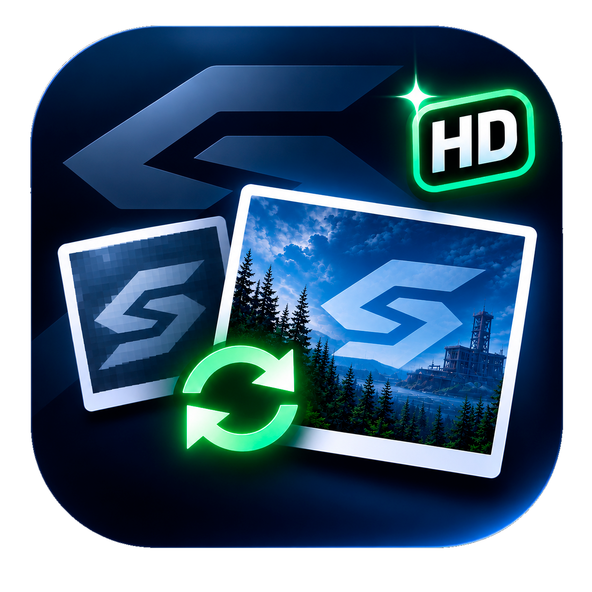

# ScreenHDSteam Studio - RU


# 📸 ScreenHDSteam Studio - Безупречное качество ваших скриншотов Steam
### Релиз: v4.2 Major Update (FREE)

> **Забудьте о «мыле», артефактах и бандинге в профиле Steam.**  
> Превратите вашу галерею Steam в настоящую выставку скриншотов без потери исходного качества!

---

## 🔍 В чем проблема скриншотов Steam?

Многие геймеры и виртуальные фотографы сталкиваются с разочарованием:
1. Вы делаете потрясающий кадр в 2K/4K с включенным рейтрейсингом (клавиша `F12`).
2. В настройках Steam у вас даже включена галочка **«Сохранять несжатую копию»**.
3. **Но есть подвох:** Steam сохраняет чистый несжатый файл (PNG/TIF/JPG) в отдельную произвольную папку на диске, а для самого клиента и облака Steam Cloud использует **пережатый JPEG низкого качества**.
4. В результате при публикации кадра в ленту активности, иллюстрации или витрину профиля цвета становятся блеклыми, темные участки покрываются «лесенками» (бандингом), а мелкие текстуры размываются.

#### Почему это сложно исправить вручную?
Каждая игра хранит скриншоты в изолированных каталогах с цифровыми идентификаторами:  
`...\userdata\<SteamID>\760\remote\<AppID>\screenshots`  
Чтобы подменить файл вручную, вам нужно:
* Найти нужный `AppID` игры.
* Переименовать исходник в точное имя файла Steam (с миллисекундным таймстампом).
* Пересохранить его в строгом формате.
* Создать уменьшенную копию (миниатюру) с правильными пропорциями в скрытую подпапку `thumbnails/`.

**ScreenHDSteam Studio делает все это за вас в один клик.**

---

## ⚙️ Как работает ScreenHDSteam Studio под капотом

1. **Анализ библиотек Steam:** утилита считывает системный реестр Windows и файлы конфигураций (`config.vdf`, `libraryfolders.vdf`), обнаруживая все ваши игровые библиотеки на дисках.
2. **Синхронизация по отпечаткам кадров:** программа анализирует папку с исходными HD-копиями и папку скриншотов конкретной игры, находя совпадения по временным меткам и именам файлов.
3. **Бескомпромиссная конвертация:** оригинальный кадр переводится в JPEG со 100% качеством и субдискретизацией `subsampling=0` (полная цветовая четкость 4:4:4, без урезания цветовых каналов, присущего алгоритмам Steam).
4. **Генерация правильных Thumbnails:** алгоритм автоматически вычисляет пропорции и генерирует четкую превью-миниатюру в подкаталог `thumbnails/`, благодаря чему оверлей Steam и менеджер скриншотов не «ломаются» и отображают кадры корректно.
5. **Безопасная атомарная замена:** запись идет через временные буферы `.tmp`. Даже при внезапном отключении питания ваши оригинальные файлы останутся в целости.

---

## 🚀 Что нового в версии v4.2 FREE

* **⚡ Полностью асинхронный многопоточный сканер (`QThread`):** приложение больше не «подвисает» при сканировании библиотек с тысячами скриншотов и объемными 4K-кадрами.
* **🎯 Умный парсинг имен:** улучшен алгоритм сопоставления кадров. Теперь поддерживаются скриншоты с числовыми префиксами AppID и модифицированными именами.
* **🎨 Новый неоновый UI на PyQt6:** полностью кастомный темный интерфейс (Frameless Window) с плавной прокруткой, анимацией загрузки и адаптивной галереей (карточки автоматически подстраиваются под ширину окна).
* **🔄 Режим кастомной замены (Custom Mode):** теперь можно не просто апгрейдить скриншоты, сделанные на F12, а подменить любой скучный кадр на внешнюю работу (обработанный арт из Photoshop, снимок через NVIDIA Ansel, фоторежим игры и т.д.).
* **🌐 Мультиязычность (RU / EN):** язык интерфейса определяется автоматически по региональным настройкам вашей системы.
* **🧹 Очистка дубликатов:** опция автоматического удаления тяжелых несжатых оригиналов после успешной замены, освобождающая гигабайты на вашем SSD.

---

## 💎 Сравнение версий: Free (v4.2) и Pro (v4.4.1)

Бесплатная версия предоставляет весь необходимый базовый функционал для ручной работы. Для тех, кто ценит максимальный комфорт, автоматизацию и полный контроль над процессом, разработана **Pro-версия**:

| Возможность / Функция | Free v4.2 (GitHub) | Pro v4.4.1 (Boosty) |
| :--- | :---: | :---: |
| Ручной апгрейд пачки скриншотов в HD | ✅ | ✅ |
| Кастомная замена кадра на любой внешний файл | ✅ | ✅ |
| Очистка несжатых оригиналов после замены | ✅ | ✅ |
| **Система лицензирования** | ❌ | ✅ |
| **Фоновая авто-замена на лету во время игры** | ❌ | ✅ |
| **Автоопределение запущенной игры через процессы Windows** | ❌ | ✅ |
| **Встроенный просмотрщик изображений с зумом и панорамированием** | ❌ | ✅ |
| **Фильтр «Только установленные игры»** | ❌ | ✅ |
| **Отображение оригинальных иконок игр в меню** | ❌ | ✅ |
| **Кастомные уведомления с превью кадра (4 угла экрана)** | ❌ | ✅ |
| **Аудио-уведомление об успешной замене** | ❌ | ✅ |
| **Работа в системном трее и автозапуск с Windows** | ❌ | ✅ |

👉 **[Получить Pro-версию и поддержать проект на Boosty](https://boosty.to/steriagame)**


---

## 📌 ВАЖНОЕ ОБЪЯВЛЕНИЕ: Статус бесплатной версии (Free)

Версия **v4.2 FREE является финальным функциональным релизом** открытой ветки. 
* Программа полностью стабильна, автономна и закрывает все базовые потребности ручной синхронизации скриншотов.
* **Бесплатная версия больше не будет получать новые функции и крупные обновления.**
* Все дальнейшие технические новшества, интеграции, фоновые алгоритмы и функции автоматизации будут развиваться и выходить исключительно в рамках **Pro-версии на Boosty**.

---

## 🤖 О разработке проекта: Человек + Искусственный Интеллект

Этот проект - наглядный пример того, на что способны современные технологии при правильном подходе. 

**Весь исходный код, архитектура приложения, логика многопоточности, алгоритмы парсинга библиотек Steam и стилизованный UI были полностью спроектированы и написаны мной в тесном сотрудничестве с Искусственным Интеллектом (Нейросетью).**

ИИ выступил в роли соавтора, системного инженера и архитектора:
* Помог выстроить безопасную работу с памятью и графикой в PyQt6.
* Написал многопоточные воркеры и парсеры реестра Windows без вызова тяжелых внешних зависимостей.
* Помог реализовать чистую математику для аудио-синтезатора волн и системы шифрования.

Это доказательство того, что с помощью ИИ сегодня можно воплощать полезные, узкоспециализированные и качественные инструменты для сообщества с нуля!

---

---

### 🛠️ Инструкция для разработчиков и сборка билда (Free v4.2)

Если вы хотите запустить проект из исходного кода или собрать собственный чистый исполняемый `.exe`-файл:

#### 1. Подготовка окружения
* Убедитесь, что установлен **Python 3.10+** (с добавлением в системный PATH).
* Склонируйте репозиторий и перейдите в папку с проектом:
  ```bash
  git clone https://github.com/STERIAGAME/ScreenHDSteam.git
  cd ScreenHDSteam
  ```

#### 2. Установка зависимостей
```bash
pip install PyQt6 Pillow pyinstaller
```
*(Опционально для чтения формата AVIF: `pip install pillow-heif`)*

#### 3. Запуск в режиме разработки
```bash
python ScreenHDSteam.py
```

#### 4. Компиляция в standalone `.exe` через PyInstaller
Чтобы упаковать скрипт и все графические ресурсы в единый портативный исполняемый файл без консольного окна, выполните команду в корне проекта:

```bash
pyinstaller --noconsole --onefile --icon=iconShdS.ico --add-data "iconShdS.ico;." --add-data "iconShdS.png;." --add-data "btn_settings.png;." --add-data "btn_refresh.png;." --add-data "btn_view.png;." --add-data "btn_mode_auto.png;." --add-data "btn_mode_custom.png;." --add-data "btn_update_git.png;." ScreenHDSteam.py
```

* **`--noconsole`** - отключает окно командной строки при запуске GUI.
* **`--onefile`** - собирает приложение в один переносимый `.exe`.
* **`--icon=iconShdS.ico`** - устанавливает иконку для файла приложения.
* **`--add-data "файл;."`** - вшивает графику интерфейса внутрь исполняемого пакета.

#### 5. Результат сборки
Готовый бинарник будет сформирован в подкаталоге **`dist`**:
```text
ScreenHDSteam/
└── dist/
    └── ScreenHDSteam.exe   <-- Готовая к запуску программа
```

---
*Создано для игрового комьюнити и ценителей качественных кадров. Спасибо за поддержку проекта!*


# ScreenHDSteam Studio - ENG


# 📸 ScreenHDSteam Studio — Flawless Quality for Your Steam Screenshots
### Release: v4.2 Major Update (FREE)

> **Forget about blurry shots, compression artifacts, and color banding on your Steam profile.**  
> Turn your Steam gallery into a true high-resolution showcase without losing original visual fidelity!

---

## 🔍 What is the problem with Steam screenshots?

Many gamers and virtual photographers run into the same frustrating issue:
1. You capture a breathtaking shot in 2K/4K with ray tracing enabled (via `F12`).
2. You even have the **"Save an uncompressed copy"** option checked in your Steam settings.
3. **Here is the catch:** Steam dumps that clean, uncompressed file (PNG/TIF/JPG) into a separate, isolated folder on your drive, while the Steam client and Steam Cloud continue to use a **heavily compressed, low-quality JPEG**.
4. As a result, when you publish your capture to your activity feed, artwork section, or profile showcase, colors look washed out, dark areas suffer from ugly color banding, and fine textures turn into a blurry mess.

#### Why is fixing this manually such a headache?
Every game stores screenshots in isolated directories with numeric identifiers:  
`...\userdata\<SteamID>\760\remote\<AppID>\screenshots`  
To replace a file manually, you would have to:
* Look up the specific game `AppID`.
* Rename your source file to match the exact Steam filename (down to the millisecond timestamp).
* Re-encode it into strict formatting parameters.
* Generate a proper downscaled thumbnail with exact aspect ratios in the hidden `thumbnails/` subfolder (otherwise, Steam will refuse to load it).

**ScreenHDSteam Studio automates this entire pipeline in a single click.**

---

## ⚙️ How ScreenHDSteam Studio works under the hood

1. **Steam Library Discovery:** Scans the Windows Registry and Steam configuration files (`config.vdf`, `libraryfolders.vdf`), automatically discovering all Steam game libraries across any drive.
2. **Fingerprint Matching:** Analyzes your uncompressed HD folder alongside the game's Steam screenshot directory, finding exact pairs via timestamps and file naming conventions.
3. **Uncompromised Conversion:** Re-encodes the original capture into JPEG at 100% quality with zero chroma subsampling (`subsampling=0` / full 4:4:4 color reproduction), eliminating the color degradation typical of Steam's native compression.
4. **Thumbnail Generation:** Automatically calculates aspect ratios and generates pixel-perfect thumbnails inside the `thumbnails/` subfolder, ensuring the Steam overlay and screenshot manager display them seamlessly.
5. **Safe Atomic Replacement:** Writes files via `.tmp` staging buffers first, preventing file corruption or data loss even in the event of an unexpected crash or power loss.

---

## 🚀 What's New in v4.2 FREE

* **⚡ Fully Asynchronous Multithreaded Scanner (`QThread`):** The UI stays completely fluid and responsive, even when indexing massive galleries filled with heavy 4K captures.
* **🎯 Smarter Filename Parsing:** Enhanced matching algorithms that accurately link captures featuring custom prefixes, timestamps, or AppID tags.
* **🎨 Modern Neon UI (PyQt6):** A sleek, frameless dark theme featuring smooth scrolling, an animated loading spinner, and an adaptive gallery grid that scales automatically with window resizing.
* **🔄 Custom Replacement Mode:** Replace any Steam screenshot with completely arbitrary external files (Photoshop edits, NVIDIA Ansel captures, photo-mode renders, or custom art).
* **🌐 Multi-Language Support (EN / RU):** Automatically detects your system language upon launch.
* **🧹 Duplicate Cleanup:** An optional toggle to delete heavy uncompressed originals after a successful upgrade, freeing up valuable space on your SSD.

---

## 💎 Version Comparison: Free (v4.2) vs. Pro (v4.4.1)

The Free version provides all the essential core features for manual workflows. For those who value maximum comfort, automation, and full control over the process, the **Pro version** is designed:

| Feature / Capability | Free v4.2 (GitHub) | Pro v4.4.1 (Boosty) |
| :--- | :---: | :---: |
| Manual batch upgrade of screenshots to HD | ✅ | ✅ |
| Custom frame replacement with any external file | ✅ | ✅ |
| Cleaning up uncompressed originals after replacement | ✅ | ✅ |
| **License key protection system** | ❌ | ✅ |
| **Background auto-replacement on-the-fly during gameplay** | ❌ | ✅ |
| **Auto-detection of running games via Windows processes** | ❌ | ✅ |
| **Built-in image viewer with zoom and panning** | ❌ | ✅ |
| **"Installed games only" filter** | ❌ | ✅ |
| **Display original game icons in the menu** | ❌ | ✅ |
| **Custom notifications with frame preview (4 screen corners)** | ❌ | ✅ |
| **Audio notification on successful replacement** | ❌ | ✅ |
| **System tray operation and Windows autostart** | ❌ | ✅ |

👉 **[Get the Pro version and support the project on Boosty](https://boosty.to/steriagame)**

---

## 📌 IMPORTANT NOTICE: Status of the Free Version

Version **v4.2 FREE is the final feature release** for the open-source branch of the project.
* The Free edition is fully stable, standalone, complete, and ready for daily use.
* **The Free version will no longer receive new feature additions or major updates.**
* All future feature development, background watcher improvements, and advanced automation workflows will be released exclusively as part of the **Pro version on Boosty**.

---

## 🤖 About Development: Human + Artificial Intelligence

This project stands as a practical showcase of what modern technologies can achieve when built through close human-machine synergy.

**The entire codebase, software architecture, multithreading logic, Steam library parsers, and custom UI design were engineered and written by me in close collaboration with Artificial Intelligence.**

AI acted as a co-creator, systems engineer, and architect throughout development:
* Designing safe memory and graphics handling routines in PyQt6.
* Implementing multithreaded workers and native Windows Registry parsers without heavy third-party bloat.
* Calculating the pure math for the real-time PCM audio chime synthesizer and hardware encryption layer.

It serves as proof that with the right workflow, developers and AI can build polished, specialized, and impactful tools for the community from the ground up!

---

### 🛠️ Developer Guide & Build Instructions (Free v4.2)

If you would like to run the project from source or compile your own clean standalone `.exe`:

#### 1. Environment Setup
* Ensure **Python 3.10+** is installed (and added to your system `PATH`).
* Clone the repository and navigate into the project directory:
  ```bash
  git clone https://github.com/STERIAGAME/ScreenHDSteam.git
  cd ScreenHDSteam
  ```

#### 2. Install Dependencies
```bash
pip install PyQt6 Pillow pyinstaller
```
*(Optional, to support AVIF/HEIC formats: `pip install pillow-heif`)*

#### 3. Run in Development Mode
```bash
python ScreenHDSteam.py
```

#### 4. Compile to Standalone `.exe` via PyInstaller
To bundle the script and all required UI assets into a single portable binary without an attached console window, run:

```bash
pyinstaller --noconsole --onefile --icon=iconShdS.ico --add-data "iconShdS.ico;." --add-data "iconShdS.png;." --add-data "btn_settings.png;." --add-data "btn_refresh.png;." --add-data "btn_view.png;." --add-data "btn_mode_auto.png;." --add-data "btn_mode_custom.png;." --add-data "btn_update_git.png;." ScreenHDSteam.py
```

* **`--noconsole`** — Hides the command-line prompt window when launching the GUI.
* **`--onefile`** — Packages the interpreter, dependencies, and code into a single binary.
* **`--icon=iconShdS.ico`** — Embeds the official icon into the executable file.
* **`--add-data "file;."`** — Packs UI sprite resources directly inside the portable package.

#### 5. Output Directory
Once the compilation finishes, your standalone executable will be located in the **`dist`** subfolder:
```text
ScreenHDSteam/
└── dist/
    └── ScreenHDSteam.exe   <-- Ready-to-run standalone program
```
The temporary `build/` directory and `.spec` file can be safely removed after compilation.

---
*Built with care for the gaming community and virtual photography enthusiasts. Thank you for your support!*
